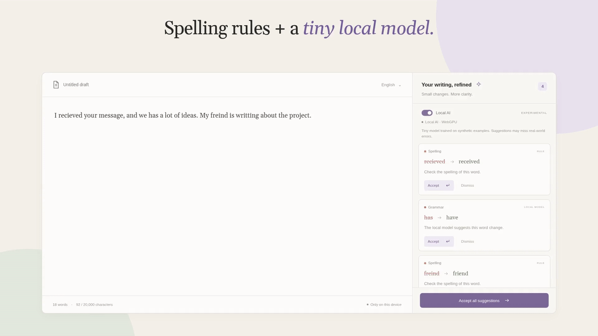

# Gamma EH

An open-source English writing assistant that checks spelling and grammar in
your browser. Your text stays on your device, and you choose which changes to accept.

**[Try the playground](https://thapecroth.github.io/gamma_eh/)** ·
[Get the Chrome extension](#chrome-extension) ·
[Read the docs](docs/README.md)

[](https://github.com/thapecroth/gamma_eh/actions/workflows/check.yml)
[](LICENSE)

<p align="center">
  <br>
  <sub><a href="docs/assets/gamma-eh-launch.mp4">Watch with sound</a> · rendered from the web editor and extension UI</sub>
</p>

- **Keep your writing private.** Checks run locally, with no account, API key, or inference server.
- **Keep your voice.** Review, accept, or dismiss suggestions. Nothing changes until you accept it.
- **Start writing right away.** Open the playground, pick an example or paste a draft, and try a correction.

Local AI starts automatically, using WebGPU where supported and local CPU
inference as a fallback. Spelling and rule suggestions keep working if the model
cannot run. You can switch Local AI off at any time.

> Gamma EH is **experimental**. The small AI model was trained on synthetic
> examples and has limited grammar coverage. Suggestions can be wrong; review
> them before applying. See the [model card](models/MODEL_CARD.md) and
> [benchmark results and plots](docs/public-benchmark.md).

The playground keeps drafts only for the current tab; reloading or closing it
loses your work. Copy your draft before leaving. [Privacy details](docs/privacy.md).

## Chrome extension

Use Gamma EH in ordinary textareas and plain-text editors on websites.
Requires **Chrome 116 or newer**.

1. Download **`gamma-eh-chrome-vX.Y.Z.zip`** from [Releases](https://github.com/thapecroth/gamma_eh/releases) and extract it into a folder you will keep. Choose the Chrome package under **Assets**, rather than the source-code ZIP.
2. Open `chrome://extensions` and enable **Developer mode**.
3. Choose **Load unpacked** and select the extracted folder containing `manifest.json`.
4. Reload a website and start typing. Click an underlined word to review a suggestion.

Use the toolbar popup to pause a site, pause all suggestions, or turn Local AI off.
This is a developer-mode install; unpacked extensions need manual updates.
Google Docs, rich document editors, single-line inputs, and embedded frames are
not supported.

[Installation, updates, and troubleshooting](apps/extension/README.md) ·
[Firefox instructions](docs/firefox.md)

## Run from source

Requires **Node.js 24.11+ (24.x)** and npm. The baseline model is included.

```sh
git clone https://github.com/thapecroth/gamma_eh.git
cd gamma_eh
npm ci
npm run dev
```

Open the local address printed in your terminal. To build the Chrome extension,
run `npm run build`, then load `dist/extension` using the steps above.

Before submitting a change, run `npm run check`. Run heavy jobs sequentially.
For browser checks and training, see the guides below.

## Explore the project

- [Documentation index](docs/README.md) — setup, support, and project guides.
- [Architecture](docs/research-and-architecture.md) — how the local engine works.
- [Training and data](docs/dataset-and-training.md) — datasets, provenance, and reproducible training.
- [Browser testing](docs/browser-testing.md) — extension and inference checks.
- [Roadmap](docs/roadmap.md) — where help is needed next.

## Help make it better

Try Gamma EH and tell us what worked or where it got in your way. Grammar
examples, browser bug reports, accessibility improvements, and code contributions
are all welcome.

[Open an issue](https://github.com/thapecroth/gamma_eh/issues) with a small,
fictional example and what you expected to happen. Keep private drafts out of
reports. For code changes, use a branch and pull request, Conventional Commits,
and focused tests.

## License

Code and trained derivative model: [Apache-2.0](LICENSE). Original generated
corpus: CC0-1.0. Base-model and dependency attributions are in [NOTICE](NOTICE).

An independent project, not affiliated with or endorsed by Grammarly.
